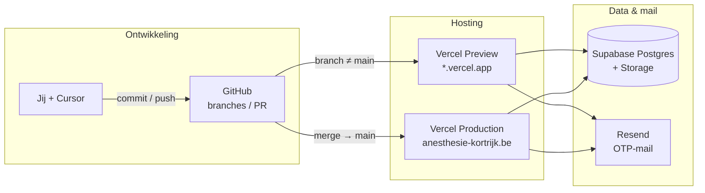
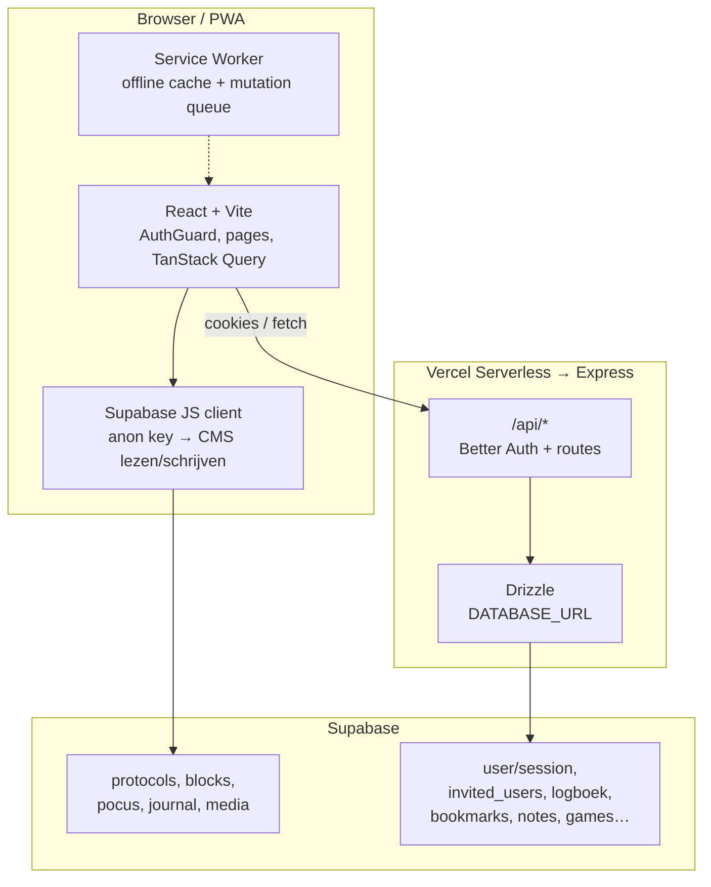

# Architectuur-overzicht

Kort: één PWA (React) + Express-API op Vercel, één Postgres op Supabase (CMS + login/logboek), GitHub als broncode, Cursor als hulp bij code — geen runtime-onderdeel.

## Wie doet wat?

| Speler | Rol |
|--------|-----|
| **GitHub** | Broncode, branches, PR’s. Featurebranches (bv. `User-login`) voor werk in progress; `main` = wat live mag. |
| **Vercel** | Bouwt & host bij elke push. Preview-URL per branch; **Production** = `main` → `anesthesie-kortrijk.be`. Env-secrets (`DATABASE_URL`, Resend, Better Auth, …). |
| **Supabase** | Eén Postgres: CMS-content (protocollen, blocks…) **én** app-data (invites, sessies, logboek, favorieten). Anon-key voor CMS in de browser; `DATABASE_URL` voor de server. |
| **Resend** | Verstuurt OTP-mails. |
| **Cursor (coding-agent)** | Werkt aan code/docs/SQL/env in de repo. Geen deel van productie; ziet alleen wat jij/auth toelaat (GitHub, Vercel-plugin, Supabase-plugin). |

**Cutover-regel:** push naar een featurebranch → alleen **Preview**. Live OTP/big bang pas na **PR merge naar `main`** → Production-deploy. Zie [AUTH_CUTOVER.md](./AUTH_CUTOVER.md) en [AUTH_PREVIEW.md](./AUTH_PREVIEW.md).

---

## Ecosysteem (hoog niveau)



---

## Interne app-architectuur



### Twee wegen naar dezelfde database

1. **Server (Drizzle + Better Auth)** — login, sessies, allowlist (`invited_users`), logboek, SMASH, favorieten, notities, highscores. RBAC in Express (`requireAuth`, `canEditCms`, …). Entry: `api/index.js` → Express (`server/`).
2. **Client (Supabase anon)** — CDS-content en admin-editor. UI checkt rol; write-bescherming hangt ook af van Supabase RLS.

Schema in code: `shared/schema.ts` (+ SQL zoals `APP_SCHEMA.sql`, `scripts/sql/user-features-tables.sql`). CMS-tabellen leven vooral via Supabase-dashboard/SQL; niet allemaal in Drizzle.

### Belangrijke mappen

| Pad | Inhoud |
|-----|--------|
| `client/` | React PWA (pages, hooks, UI) |
| `server/` | Express, Better Auth, Drizzle-routes |
| `shared/` | Schema + permissions (gedeeld client/server) |
| `api/` | Vercel serverless entry naar Express |
| `docs/` | Auth, invites, cutover, dit overzicht |
| `content/` | Lokale markdown (fallback / migratie; productie-CDS = Supabase) |

---

## Van code tot “live”

```mermaid
sequenceDiagram
  participant Dev as Jij / Cursor
  participant GH as GitHub
  participant V as Vercel
  participant U as Gebruiker
  participant S as Supabase
  participant R as Resend

  Dev->>GH: push featurebranch
  GH->>V: Preview deploy
  Note over V: testbaar; Production onaangeroerd

  Dev->>GH: PR merge → main
  GH->>V: Production deploy
  U->>V: opent anesthesie-kortrijk.be
  U->>V: vraagt OTP
  V->>S: check invited_users
  V->>R: stuur code
  U->>V: login
  V->>S: session + users
  U->>S: leest protocols/blocks via anon
  U->>V: logboek / favorieten via /api
  V->>S: Drizzle writes
```

---

## Map in één zin

- **Repo** = wat de app *is* (UI + API + schema).
- **Vercel** = waar die code *draait* + secrets.
- **Supabase** = waar *gegevens* blijven (content + gebruikers).
- **GitHub** = *wie welke versie* mag (Preview vs Production).
- **Cursor** = *werkt aan de repo*; deployt niets zelf tot jij pusht/merget.

---

## Gerelateerde docs

- [AUTH_PREVIEW.md](./AUTH_PREVIEW.md) — Preview-checklist & zero-downtime cutover
- [AUTH_CUTOVER.md](./AUTH_CUTOVER.md) — Production big-bang (pad B)
- [INVITES_SUPABASE.md](./INVITES_SUPABASE.md) — Allowlist beheren
- [AUTH_ENV.md](./AUTH_ENV.md) — Env-variabelen
